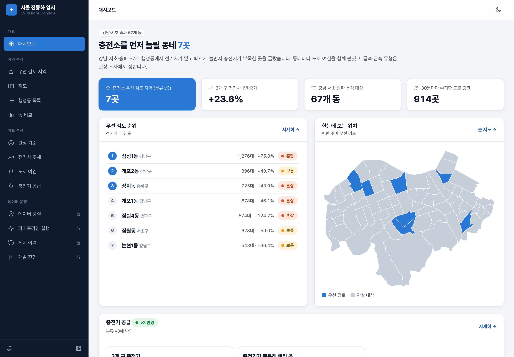
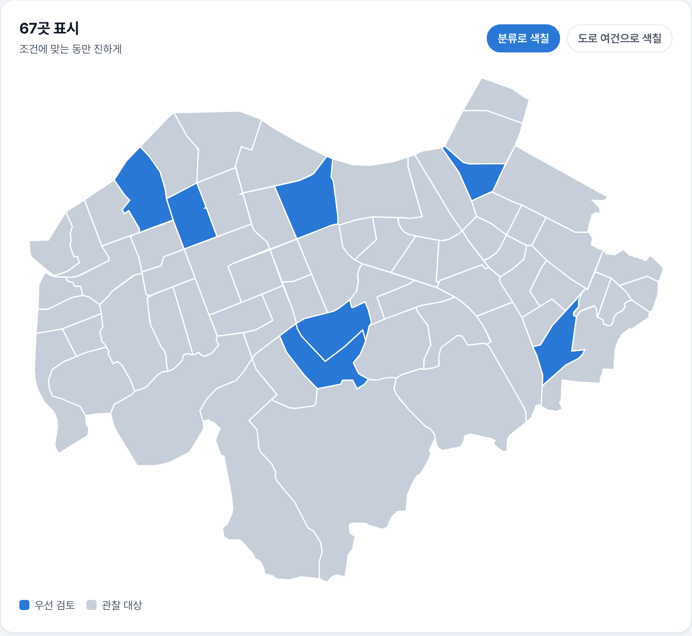
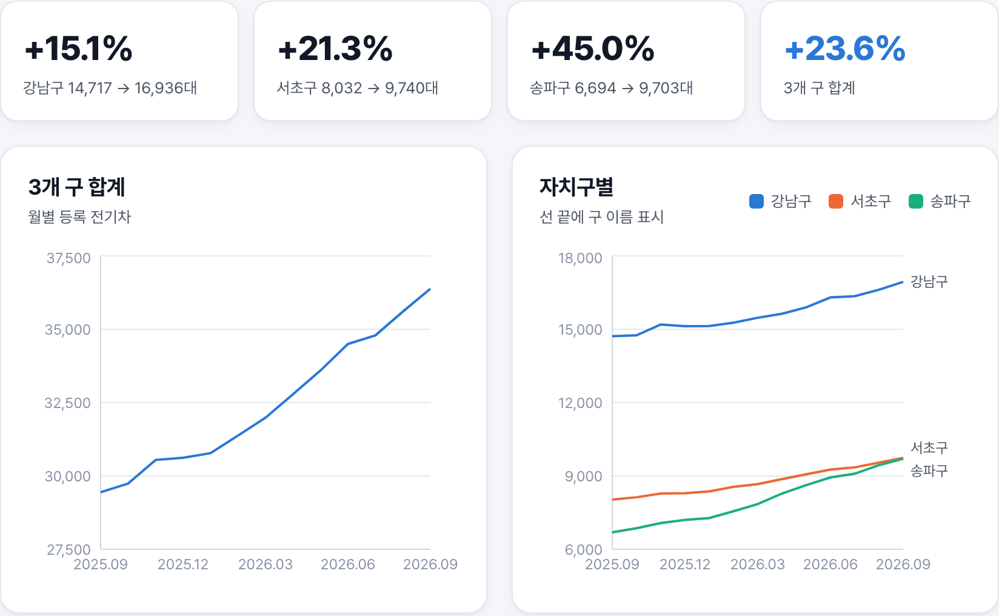
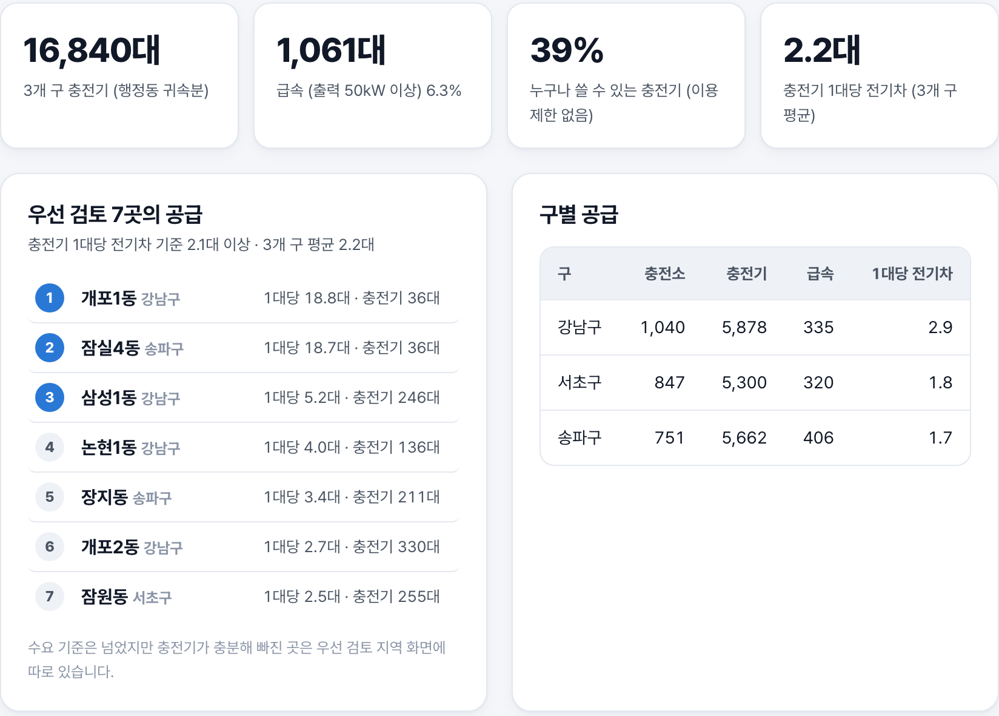
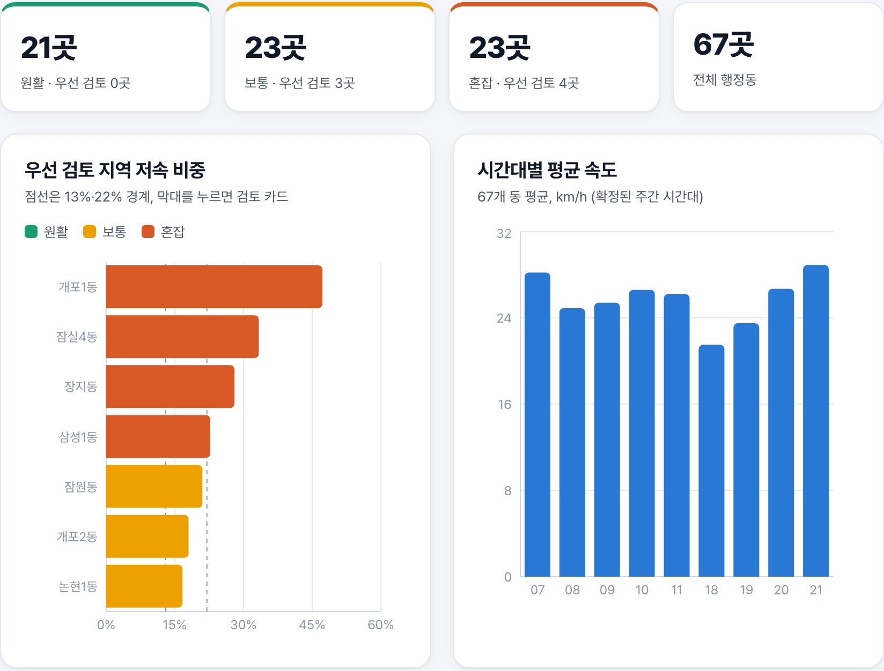
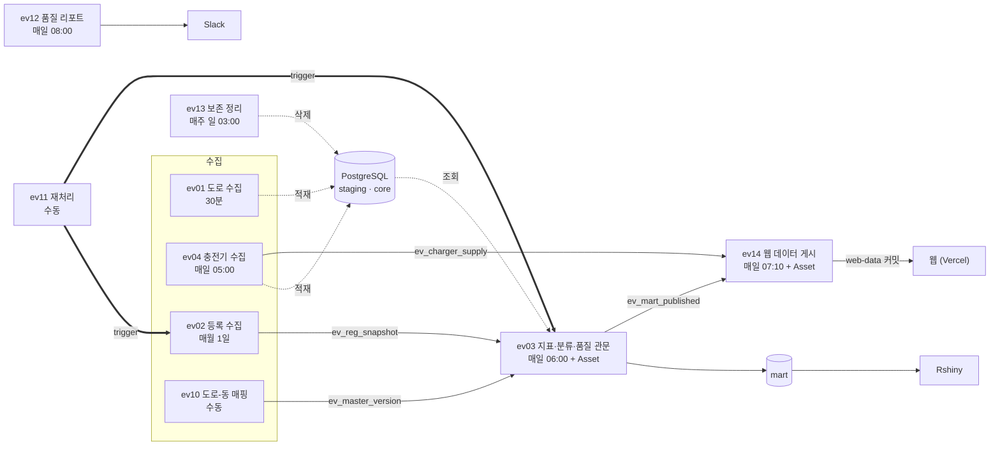
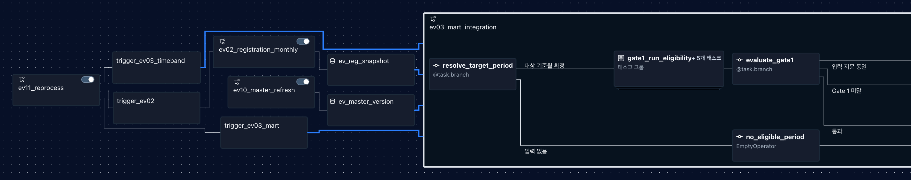
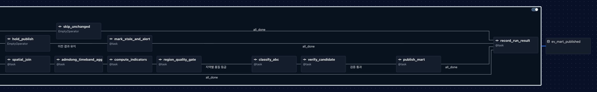
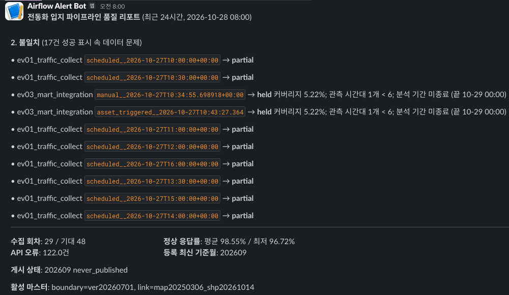

# 서울 전동화 입지 인사이트 플랫폼

강남·서초·송파 67개 행정동에서 **충전소를 먼저 늘릴 동네**를 매일 자동으로 고르는 Airflow 파이프라인.

🚀 https://seoul-ev-insight.vercel.app

| 67개 동 | 914곳 | 16,840대 | 3단계 | **7곳** |
|:---:|:---:|:---:|:---:|:---:|
| 분석 행정동 | 30분마다 수집하는 도로 | 매일 수집하는 충전기 | 품질 관문 | 충전소 우선 검토 지역 |

## 결과

### 우선 검토 7곳

| 도로 여건 | 동 (충전기 1대당 전기차) |
|---|---|
| 혼잡 4곳 | 개포1동 18.8 · 잠실4동 18.7 · 삼성1동 5.2 · 장지동 3.6 |
| 보통 3곳 | 개포2동 2.7 · 잠원동 2.5 · 논현1동 4.0 |

- 기준: 전기차 522대 이상 + 1년 증가율 39.7% 이상 + 충전기 1대당 전기차 2.1대 이상
- 충전기가 이미 충분해 빠진 5곳: 세곡동, 잠실2동, 청담동, 문정2동, 도곡2동

### 전기차 추세 — 3개 구 1년 +23.6%

### 충전기 공급 — 우선 검토 7곳 모두 3개 구 평균(2.2대) 이상

### 도로 여건 — 우선 검토 7곳 중 4곳 혼잡

> 기준: 등록 2026-09 · 도로 10/27~28 관측 · 충전기 11/02 수집 (분류 `mvp_v3`)

## 구현

| 영역 | 구현 내용 |
|---|---|
| 수집 | 도로 30분 · 충전기 일 1회 · 등록 월 1회, DAG 분리 |
| 정제·연결 | 이상값 격리, 도로 링크를 행정동에 지도 매칭(버전 관리), 충전기 SCD2 이력 |
| 판정·공개 | 품질 관문 3단계 통과분만 한 트랜잭션으로 마트 교체 |
| 운영 | 재처리 단일 진입점, Slack 일일 품질 리포트, 조건부 보존 정리 |
| 웹 | 결과 데이터 자동 게시(web-data 브랜치) → Vercel, Google·카카오 로그인·역할별 운영 화면 |
| CI/CD | `lint` → `test` → `validate_dag` → `validate_ddl` 통과해야 main 병합, 웹 빌드 별도 확인 |

Airflow 3.3.2 (CeleryExecutor) · PostgreSQL 16 + PostGIS · React + Vite · Supabase · Vercel · Rshiny

### DAG 관계도

실선 = Asset 이벤트 · 점선 = DB 적재·조회 · 굵은 선 = TriggerDagRun

| DAG | 역할 | 실행 |
|---|---|---|
| ev01 | 도로소통 수집·시간대 집계 | 30분 |
| ev02 | 등록현황 월 스냅샷 | 매월 1일 09:00 |
| ev03 | 적격성 확인 → 지표·분류 → 마트 게시 | 매일 06:00, ev02·ev10 Asset |
| ev04 | 충전기 공급 일 스냅샷 | 매일 05:00 |
| ev10 | 링크 매핑·행정동 경계 버전 | 수동 |
| ev11 | 재처리 요청 진입점 (등록·시간대·마트) | 수동 |
| ev12 | Airflow 상태 × 데이터 상태 리포트 | 매일 08:00 |
| ev13 | 조건부 보존 정리 (기본 dry_run) | 매주 일 03:00 |
| ev14 | 웹 결과 데이터 게시 | 매일 07:10, ev03·ev04 Asset |

- ev01은 Asset 대신 DB 조회로 연결 (하루 48번 재계산 방지)
- ev03은 입력 지문이 같으면 재계산 생략

### 통합 DAG (ev03)

### 품질 관문

| 관문 | 기준 | 미달 시 |
|---|---|---|
| 1. 3개 구 전체 | 도로 관측률 60% 이상 | 공개 보류, 지난 결과 유지 |
| 2. 동네마다 | 관측률 60%, 관측 6시간, 도로 3곳 이상 | 데이터 보완 필요 |
| 3. 통과한 동 | 전기차 522대, 1년 증가율 39.7% 이상 | 관찰 대상 |

### 운영 검증

| 상황 | 결과 |
|---|---|
| 회차마다 일부 도로 값 누락 (40회 중 25회) | 받은 값 저장, '부분 성공' 기록 |
| 분석 기간 미충족 상태로 06:00 실행 (4회) | 관문 1에서 공개 보류 + Slack 알림 |
| 11개월 백필 중 ev03 자동 시작 10회 | 입력 지문 비교로 10회 모두 재계산 생략 |
| '성공'이지만 데이터 부족한 실행 | 08:00 품질 리포트가 17건 탐지 (10/28) |

## 문서

- 설계: [docs/dag_design.md](docs/dag_design.md)
- 실행: [RUNNING.md](RUNNING.md)
- 로그인·권한: [docs/auth_setup.md](docs/auth_setup.md)
- 형상 관리: [CONTRIBUTING.md](CONTRIBUTING.md)
