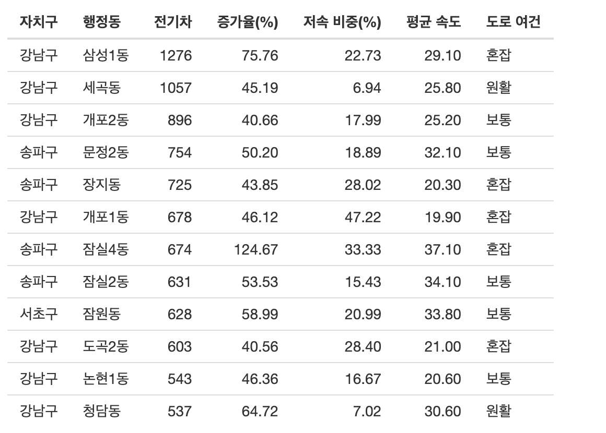
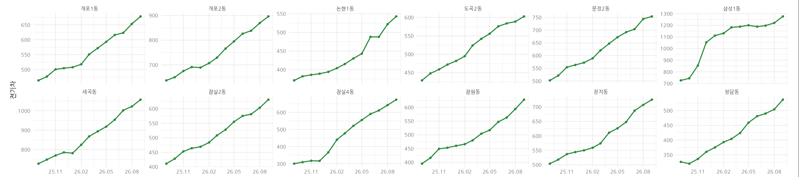
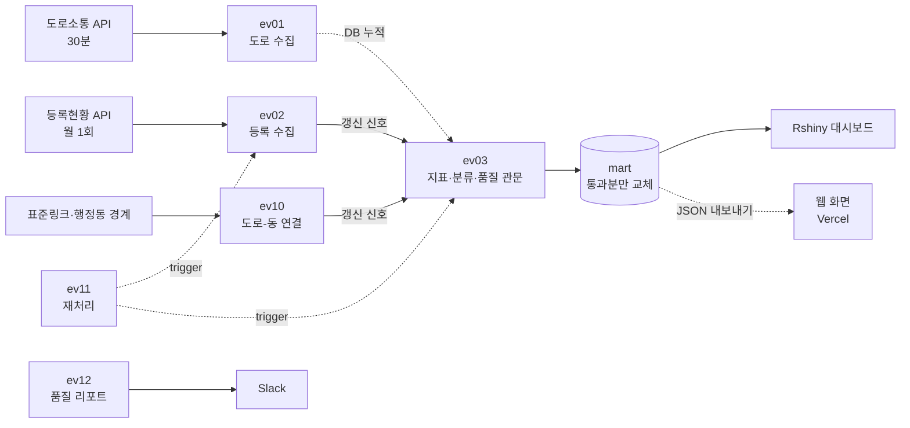
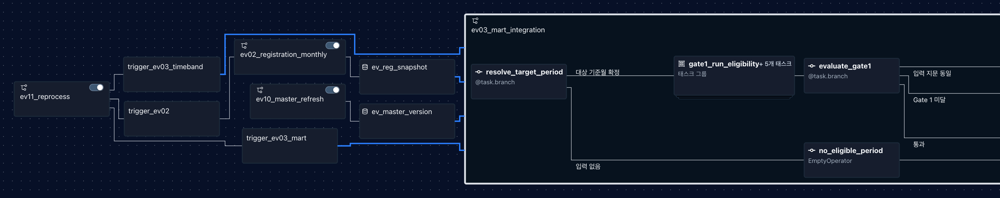
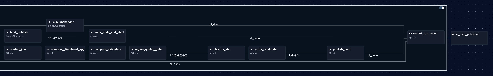
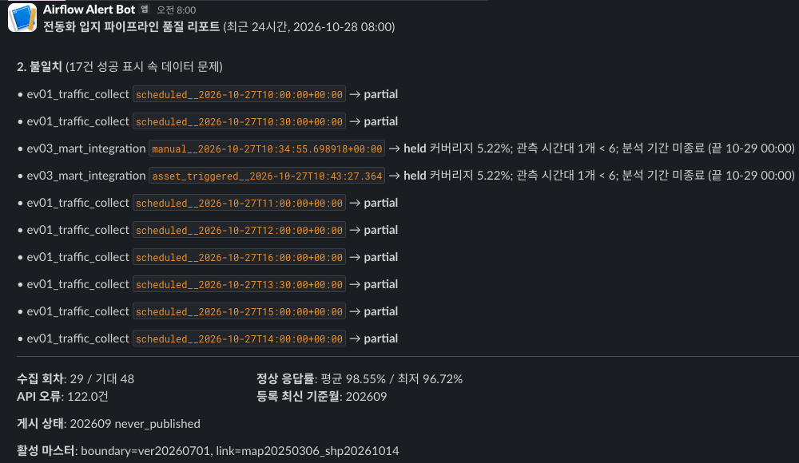

# 서울 전동화 입지 인사이트 플랫폼

전기차 등록현황(월 1회)과 실시간 도로소통정보(30분)를 행정동 단위로 맞춰, 충전소를 먼저 늘릴 동네를 매일 자동으로 고르는 Airflow 파이프라인. 품질 기준을 통과한 결과만 공개한다.

**배포정보
🚀https://seoul-ev-insight.vercel.app** (2026-10-28 게시 결과 스냅샷)

설계는 [docs/dag_design.md](docs/dag_design.md), 형상 관리 규칙은 [CONTRIBUTING.md](CONTRIBUTING.md), 실행 방법은 [RUNNING.md](RUNNING.md) 참고.

| 67개 동 | 914곳 | 3단계 | 12곳 |
|:---:|:---:|:---:|:---:|
| 강남·서초·송파 행정동 | 30분마다 수집하는 도로 | 품질 관문 | 충전소 우선 검토 지역 |

## 결과

### 우선 검토 12곳과 도로 여건

등록 2026년 9월 · 도로 10/27~28 관측 기준. 전기차 대수·1년 증가율로 우선 검토 지역을 고르고, 도로 저속 비중으로 동네 도로 여건을 붙인다.

| 도로 여건 | 저속 비중 | 동 |
|---|---|---|
| 원활 2곳 | 13% 미만 | 세곡동, 청담동 |
| 보통 5곳 | 13~22% | 개포2동, 문정2동, 잠실2동, 잠원동, 논현1동 |
| 혼잡 5곳 | 22% 이상 | 삼성1동, 개포1동, 잠실4동, 장지동, 도곡2동 |

급속·완속 유형은 현장 조사에서 정한다.

### 13개월 추세

3개 구 전기차 29,443 → 36,379대(+23.6%), 12개월 연속 증가.

- 12곳 모두 12개월 중 11~12개월 증가. 잠실4동 +125%도 한 번에 뛴 게 아님
- 대치2동: 1년 증가 대부분이 2025년 11월 한 달에 몰림 → 원인 확인 필요
- 반포본동: 최근 3개월 +57%(직전 3개월의 5배) → 다음 갱신 때 우선 확인

## 전체 구조

| 단계 | 하는 일 | DAG | 스키마 |
|---|---|---|---|
| ① 수집 | 원본 그대로 저장 | ev01, ev02 | staging |
| ② 정제·연결 | 이상값 격리, 도로를 소속 동에 지도 매칭(버전 관리) | ev10 | core, quarantine |
| ③ 검증·공개 | 품질 확인 후 통과분만 한 트랜잭션으로 교체 | ev03 | mart |
| ④ 활용·운영 | 대시보드·웹 화면, Slack 알림, 재처리, 보존 정리 | ev11~13, Rshiny, web | ops |

주기가 다른 수집은 DAG를 나눠 따로 돌린다. 통합 DAG ev03은 새 데이터 신호나 매일 06:00에 시작해, 수집 완료를 기다리지 않고 DB에 쌓인 값으로 판단한다.

### 통합 DAG (ev03)

### 품질 관문

| 관문 | 기준 | 미달 시 |
|---|---|---|
| 1. 3개 구 전체 | 도로 관측률 60% 이상 | 공개 보류, 지난 결과 유지 |
| 2. 동네마다 | 관측률 60%, 관측 6시간, 도로 3곳 이상 | 데이터 보완 필요 |
| 3. 통과한 동 | 전기차 522대, 1년 증가율 39.7% 이상 (67개 동 상위 40% 경계, 잠정) | 관찰 대상 |

## 운영에서 확인한 것

| 문제 | 해결 |
|---|---|
| 회차마다 일부 도로 값 누락 (40회 중 25회) | 받은 값은 저장, 회차는 '부분 성공'으로 기록 |
| 분석 기간이 덜 찼는데 06:00 정기 실행 (4회) | 관문 1에서 공개 보류, Slack 알림 |
| 과거 11개월 백필 중 통합 DAG 10회 자동 시작 | 입력 지문 비교로 10회 모두 재계산 생략 |

매일 08:00 품질 리포트가 '성공'으로 끝났지만 데이터가 부족한 실행을 찾아낸다. 10/28 리포트에서 17건 발견.

## CI/CD

`lint` → `test` → `validate_dag` → `validate_ddl` 4단계를 GitHub Actions로 실행하고, 통과해야 보호 브랜치 main에 병합된다. `build`·`deploy`까지 포함한 6단계는 `.gitlab-ci.yml`로 설계. `web/`이 바뀌면 웹 빌드(`web_build`)를 따로 확인하고, main에 병합되면 Vercel이 자동 배포한다.
